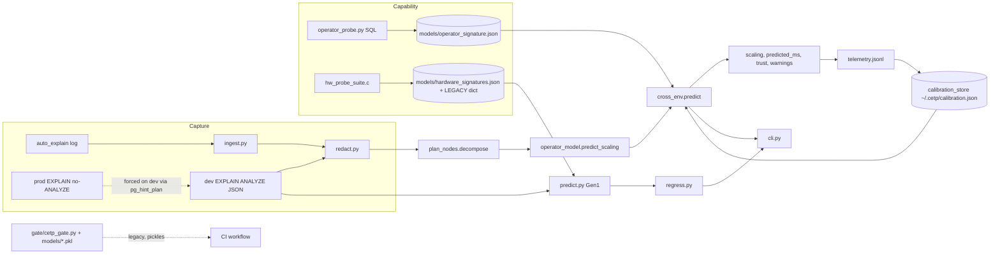

# 01 — Project overview and architecture

## Overview [OBS from README, pyproject, code]
**CETP — Cross-Environment (TPC-H) Runtime Prediction.** Academic capstone (PES University per the paper's author block; README says "Academic capstone project"). Predicts how long a PostgreSQL query will take on a *production* machine from an `EXPLAIN (ANALYZE…)` captured on a *development* machine plus a description of each machine's capability. Intended use: CI/CD check that flags likely SLA violations or regressions before deployment. Version `0.4.0`, classifier "Alpha" (`pyproject.toml`). README: "treat the product as alpha."

**There are two generations of the method living in one repo — this is the single most important thing to understand.**

| | Gen 1 "roofline" (Aug–early Oct 2026) | Gen 2 "per-operator" (2026-10-13, branch `x86-probe`) |
|---|---|---|
| Machine description | 2 scalars: STREAM-bandwidth + multi-core FP GFLOPS (C probe `hw_probe_suite.c`) | 5 SQL-measured operator rates + `parallel_speedup` (`operator_probe.py`) |
| Model | analytical roofline `0.5/bw + 0.25/cmp + 0.25·√(·)` or `1/compute_ratio` | `Σ w_op · rate_dev/rate_prod · card_op`, weights from dev plan self-time |
| Data | 5 EC2 types × 21 TPC-H queries, SF1 | 22 TPC-H queries × 13 environments (8 docker cells, GHA x86 runners, M1 laptop) |
| Code | `cetp/predict.py`, `signature.py`, `regress.py`, `gate/` | `cetp/operator_model.py`, `plan_nodes.py`, `cross_env.py`, `calibration_store.py`, `ingest.py`, `telemetry.py` |
| Status | evaluated; README headline | README says Gen 1 "is being replaced"; Gen 2 evidence is in `results/operator_model_metrics.json` etc. |

README's own banner [CLAIM]: the one experiment testing the real claim (arm64 laptop → x86 EC2) scored **324% MAPE vs 123% for assuming prod = dev**.

## Entry points [OBS]
`pyproject.toml [project.scripts]`: `cetp = cetp.cli:main`, `cetp-redact = cetp.redact:main`.
CLI subcommands (`cetp/cli.py:293-367`): `predict`, `regress`, `redact`, `signature {list|probe}`, `predict-prod`, `selftest`.
Other: `python gate/cetp_gate.py [--demo]`; `make results|test|gate-demo|probe-here|grid-*|operator-results|docs-all`; VS Code extension (`vscode-extension`, spawns the Python backend); 3 GitHub workflows.

## Architecture (as implemented)

Boundaries: no network service, no database server of its own; persistence is local JSON/JSONL files (`~/.cetp/…`, overridable by `CETP_CALIBRATION_PATH`, `CETP_TELEMETRY_PATH`). Runtime deps of the `cetp` package: **none** (`dependencies = []`); scikit-learn/numpy/pandas/scipy only for research scripts and the legacy gate. No authentication; privacy boundary is `redact.py` (see 02 §Redaction).

## Component responsibilities [OBS]
| File | Responsibility | Status |
|---|---|---|
| `cetp/predict.py` | Gen-1 prediction: plan features, `analytical_scaling`, `compute_only_scaling`, conformal bounds from `models/calibration.json`, hardware-distance confidence | active |
| `cetp/signature.py` | frozen `LEGACY` 5-machine table, registry reader, `ratios()` (refuses mixed scales), warnings | active (legacy-data-bound) |
| `cetp/regress.py` | before/after plan comparison; hardware term cancels in ratio; verdict REGRESSION/NEUTRAL/IMPROVEMENT at 1.20× | active, README's "recommended mode" |
| `cetp/plan_nodes.py` | EXPLAIN → per-node self-time (undo cumulative + per-loop), node→probe-axis map, `under_gather` flag | active |
| `cetp/operator_model.py` | per-operator scaling, cardinality factor, concurrency factor, few-shot calibration, calibration-query selection | active; cardinality term "implemented but not validated" |
| `cetp/cross_env.py` | product flow wrapper; refuses uncalibrated cross-ISA prediction; trust grade; warnings | active |
| `cetp/calibration_store.py` | per-(dev,prod) median-ratio correction; atomic JSON | active |
| `cetp/ingest.py` | parse `auto_explain` JSON logs, redact, rank `pg_stat_statements` | active |
| `cetp/telemetry.py` | JSONL prediction log → later resolved with actual; MAPE vs naive | active |
| `cetp/redact.py` | strip literals / hash identifiers from plans; `assert_clean` | active |
| `gate/cetp_gate.py` | legacy 3-state SLA gate using RF classifier + GBR quantile pickles | legacy; used by CI `cetp-gate.yml` |
| `scripts/collection/` | measurement harnesses (collect, container_grid, operator_probe, hw probes, plan-drift) + 22 TPC-H, 99 TPC-DS, JOB SQL files | data-generation, not run here |
| `scripts/analysis/` | ~33 experiment scripts; `canonical_evaluation.py` is the declared source of truth | partially executed |
| `models/` | pickles + `calibration.json`, `operator_signature.json`, `PROVENANCE.json` | see 06 for staleness contradictions |
| `models_backup/`, `models_online/v2/` | superseded artifacts | obsolete (PROVENANCE: backup = single-core, buggy dataset, sklearn 1.6.1) |
| `data/raw_buggy_do_not_use/` | pre-correction dataset kept as evidence | do not use |
| `vscode-extension/` | sidebar + commands wrapping the Python backend (v0.2.4; `.vsix` present) | active, uncommitted edits |
| `site/index.html`, `docs/` | project page; PDFs generated from deleted Markdown | docs |

## Scope notes
Declared out of scope / unsupported (CANONICAL §8, README): other hardware, non-EBS storage, scale factors ≠ SF1, concurrent workloads (except a default elasticity exponent), queries outside the evaluated set, coverage guarantees outside the calibration machines.
